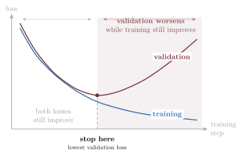

# Training: Loss and Stochastic Gradient Descent {#sec-04-training-loss-sgd}

<!-- lecture-source: m01_lecture-1-from-linear-regression-to-neural-netwo_-bdoWPWjyTc.txt (SGD half),
     [coding]_m03_lecture-3-optimization-foundations-ablation-meth_V0l6b5R6Vkw.txt
     spine: ~/dl-course-code/ds6050_01_foundations/MODULE_NOTES.md (§14–23)
     seeds: sources/1_3_sgd_lecture_notes.tex, sources/1LS-2_loss_SGD.tex, sources/misc_1-SGD.tex
     additional reference: ../Resources/Gil Strang/SGD.pdf, §VI.5, especially pp. 361–365 -->

We now have models for practical tasks: linear regressors (@sec-01-linear-regression),
classifiers (@sec-02-logistic-softmax), and multilayer perceptrons
(@sec-03-nonlinearity-mlp). We have losses that score their predictions against truth, and we
know the direction of improvement is the negative gradient. What remains is the central
engineering challenge: how to run the descent when the dataset has a million examples, the
model has millions of parameters, and the loss landscape is no longer a convex bowl.

Stochastic gradient descent is the basic optimization method, augmented by minibatching,
momentum, and adaptive per-parameter scaling.
These refinements turn a simple theoretical concept into the practical algorithm
that trains every network in this book.

## Likelihood-derived loss functions {#where-losses-come-from-one-more-time}

Before optimizing a loss, we recall why we choose the loss we do. In
@sec-01-linear-regression we saw that assuming Gaussian noise on a linear process reduces
maximum likelihood to least squares, and in @sec-02-logistic-softmax the same
argument with a categorical distribution produced cross-entropy. Both follow one
principle: **a likelihood-derived loss is a noise model in disguise.** Specifying the
conditional distribution of targets around predictions determines how errors are
penalized, and negative log-likelihood turns that model into the scalar objective that
training minimizes.

With the loss fixed, training minimizes the average loss:

$$
\hat{\vect{w}} = \argmin_{\vect{w}} \; \loss(\vect{w})
= \argmin_{\vect{w}} \; \frac{1}{n}\sum_{i=1}^{n} \ell_i(\vect{w}),
$$ {#eq-train-objective}

where $\ell_i$ is the loss on example $i$. The rest of this chapter addresses how to minimize
this objective when $n$ is massive: making rapid, reliable progress without evaluating every
term at every step.

## The computational bottleneck

Gradient descent, as we left it in @sec-01-linear-regression, updates with the *full*
gradient:

$$
\vect{w}^{(t+1)} = \vect{w}^{(t)} - \eta \, \frac{1}{n}\sum_{i=1}^{n} \nabla \ell_i(\vect{w}^{(t)}).
$$ {#eq-full-gd}

One step touches every example. Modern datasets have millions to billions of examples,
models have millions to billions of parameters, and training needs thousands of steps. At
this scale, computing an exact gradient at every step is too expensive.

## Stochastic gradient descent

We can estimate the gradient without evaluating every training example. Instead of the expensive sum over all $n$ examples, average over a small random
**minibatch** $\mathcal{B}$, e.g., 32 examples against a million:

$$
\vect{w}^{(t+1)} = \vect{w}^{(t)} - \eta \, \frac{1}{|\mathcal{B}|}\sum_{i \in \mathcal{B}} \nabla \ell_i(\vect{w}^{(t)}).
$$ {#eq-sgd}

Why does this work? At a *fixed* parameter vector, a uniformly sampled minibatch
gradient is **unbiased**: the expected contribution of example $i$ to a batch equals
its contribution to the full average, so

$$
\E\bigl[\nabla \loss_{\mathcal{B}}(\vect{w})\bigr] = \nabla \loss(\vect{w}).
$$ {#eq-unbiased}

Here the expectation is over the random draw of the minibatch from the fixed training set.
The identity holds for independent draws with replacement and also for one uniformly
chosen subset without replacement.^[At a fixed $\vect{w}$, a subset of size $B$ drawn
without replacement is unbiased, and its variance is the with-replacement variance times
the finite-population correction $(n-B)/(n-1)$, which reaches zero at $B=n$. Across an
epoch, however, reshuffled batches create path dependence between iterates, and dedicated
random-reshuffling theory handles that sequence.] In either case, the minibatch gradient
equals the full-data gradient in expectation.

There is a second, physical reason to batch. The hardware that trains networks is built
around batched general matrix multiplication (GEMM). A dense layer applied to
$B$ examples is one matrix product in which every weight, once read from memory, is
reused for all $B$ examples. Batching lets several examples share the cost of moving the
weights. The resulting throughput depends on the shapes and the hardware, so it
should be measured. Batch size therefore
trades gradient noise against hardware efficiency, and we return to both sides below and
in @sec-04-estimator-cases.

In practice the algorithm runs as follows:

1. Shuffle the training data.
2. Split it into minibatches of size $B$.
3. For each batch: compute the average gradient, update the parameters.
4. One pass through all batches is an **epoch**. Repeat for multiple epochs.

## Gradient-dominated and noise-dominated behavior {#the-two-zones-of-sgd}

On the noisy least-squares problem below, fixed-step SGD illustrates two regimes, a
pattern often called **semi-convergence**: gradient-dominated progress early, then
persistent variation near the solution. The mechanism is a shifting balance between
signal and noise. At any parameter vector, split the minibatch gradient into the full gradient plus a noise vector
$\vect{\xi}_{\mathcal{B}}$ whose mean is zero by the unbiasedness in @eq-unbiased:

$$
\nabla\loss_{\mathcal B}(\vect{w})
= \nabla\loss(\vect{w}) + \vect{\xi}_{\mathcal B},
\qquad
\E[\vect{\xi}_{\mathcal B}]=\vect{0}.
$$

On our convex least-squares bowl the two regimes are easy to see:

- **Far from the optimum, signal dominates.** The full gradient is large relative to
  the batch noise, so most batch directions make useful progress, and their mean is the
  full descent direction.
- **Near the optimum, noise dominates.** The full gradient shrinks toward zero
  (recall @fig-gd-path), but
  individual batches still disagree because different examples
  pull in different directions. With a fixed learning rate the iterate keeps bouncing
  inside what we will call the **region of confusion**:

:::: {.plan-code .plan-code-wide}
::: {.plan}
1. Generate one least-squares problem and solve for its empirical optimum.
2. Partition the examples into equal batches and define their gradients.
3. Compare batch descent directions far from and at the optimum.
4. Verify that their fixed-point mean equals the full descent direction, then plot both regimes.
:::

```{python}
#| label: fig-sgd-zones
#| fig-alt: "Two panels show batch descent arrows on the same convex loss contours. Far from the optimum, orange batch arrows cluster around a blue full-gradient arrow. At the optimum, the blue mean is nearly zero while orange batch arrows point in conflicting directions inside a shaded region."
#| fig-cap: "The two regimes at fixed parameter vectors. Left: equal-size batch directions vary, but their mean overlaps the full descent direction and points down the convex bowl. Right: at the empirical optimum the full gradient is essentially zero while individual batches still disagree, so finite steps create a region of confusion. Within each panel every batch arrow is drawn at the same length, so the arrows compare directions only. The shaded disc is schematic."
#| code-summary: "Code: expectation and the region of confusion"
#| code-fold: false
import torch
import numpy as np
import matplotlib.pyplot as plt
torch.set_num_threads(4)  # pinned: results depend on the CPU thread count

# [1]
torch.manual_seed(6050)
x1 = torch.randn(80)
y1 = 2.5 * x1 - 1.0 + 0.4 * torch.randn(80)
A = torch.stack([x1, torch.ones_like(x1)], dim=1)
optimum = torch.linalg.lstsq(A, y1).solution

# [2]
batch_size = 4
batches = torch.randperm(len(x1)).reshape(-1, batch_size)

def gradient_at(theta: torch.Tensor, idx=slice(None)) -> torch.Tensor:
    residual = A[idx] @ theta - y1[idx]
    return 2 * A[idx].T @ residual / len(residual)

def batch_descent_directions(theta: torch.Tensor) -> torch.Tensor:
    return torch.stack([-gradient_at(theta, idx) for idx in batches])

# [3]
points = [torch.tensor([-0.5, 2.0]), optimum]
titles = ["far away: agreement in expectation",
          "at the optimum: batches disagree"]
arrow_lengths = [0.72, 0.46]

W, B = np.meshgrid(np.linspace(-1.5, 5.5, 100),
                   np.linspace(-4.0, 3.0, 100))
L = ((y1.numpy()[None, None, :] -
      (W[..., None] * x1.numpy() + B[..., None])) ** 2).mean(-1)

# [4]
fig, axes = plt.subplots(1, 2, figsize=(9.2, 3.7), sharex=True, sharey=True)
for ax, theta, title, length in zip(axes, points, titles, arrow_lengths):
    directions = batch_descent_directions(theta)
    full_direction = -gradient_at(theta)
    assert torch.allclose(directions.mean(0), full_direction, atol=2e-6)

    unit = directions / directions.norm(dim=1, keepdim=True).clamp_min(1e-12)
    origin = theta.repeat(len(unit), 1)
    ax.contour(W, B, L, levels=24, cmap="Blues", alpha=0.55)
    ax.quiver(origin[:, 0], origin[:, 1], unit[:, 0], unit[:, 1],
              color="#E57200", alpha=0.32, angles="xy",
              scale_units="xy", scale=1 / length, width=0.008)

    if full_direction.norm() > 1e-5:
        mean_unit = full_direction / full_direction.norm()
        end = theta + 1.15 * mean_unit
        ax.annotate("", xy=end, xytext=theta,
                    arrowprops={"arrowstyle": "->", "lw": 3, "color": "#232D4B"})
    else:
        ax.text(float(theta[0]), float(theta[1]) + 0.72,
                "mean direction $\\approx 0$", ha="center", color="#232D4B")

    ax.plot(*optimum, marker="*", ms=13, color="#2F855A")
    ax.plot(*theta, marker="o", ms=5, color="#232D4B")
    ax.set(title=title, xlabel="$w$", xlim=(-1.5, 5.5), ylim=(-4, 3))
    ax.grid(alpha=0.12)

axes[0].set_ylabel("$b$")
axes[0].plot([], [], color="#E57200", lw=3, alpha=0.45,
             label="batch directions")
axes[0].plot([], [], color="#232D4B", lw=3,
             label="mean = full direction")
axes[0].plot([], [], marker="*", ms=10, color="#2F855A", lw=0,
             label="empirical optimum")
axes[0].legend(loc="upper right", fontsize=8)
axes[1].add_patch(plt.Circle(optimum.numpy(), 0.82, color="#722F37",
                             alpha=0.09, zorder=0))
axes[1].text(float(optimum[0]), float(optimum[1]) - 1.05,
             "region of confusion", ha="center", color="#722F37")
plt.tight_layout()
plt.show()
```
::::
In some regimes the bouncing is an advantage. A noisy step may push the iterate away from a
*saddle point*, where the loss rises in some directions and falls in others, or out of a
narrow basin or a shallow trap that exact descent would follow more predictably. Minibatch
noise can also bias training toward different solutions, and smaller batches sometimes improve
generalization. None of these outcomes is guaranteed. The effect depends on the model and the
data, and on training choices such as the initialization, the order of the batches, the
learning rate, and the batch size. For now, treat noise as part of the algorithm, with effects
that can help or hurt.

## The learning rate

The learning rate $\eta$ is a **hyperparameter**, a setting we choose before training
instead of learning it, and few hyperparameters matter more. It scales every step, and its
failure modes are asymmetric: too small a learning rate can produce slow progress, while
one that is too large overshoots the valley and diverges.

:::: {.plan-code}
::: {.plan}
1. Define the reusable `losses_for` helper.
2. Open one figure for the three loss curves.
3. Implement the learning-rate triptych.
4. Add a legend naming each learning rate and show the figure.
:::

```{python}
#| label: fig-lr
#| fig-alt: "Three log-loss curves separate by learning rate: the smallest declines slowly, the middle rate falls rapidly to a floor, and the largest climbs steadily instead of converging."
#| fig-cap: "Same problem, same steps, three learning rates. The smallest makes slow progress, the largest makes the loss climb at every step, and the middle one converges quickly."
#| code-summary: "Code: the learning-rate triptych"
#| code-fold: false
# [1]
def losses_for(lr: float, steps: int = 60) -> list[float]:
    w, b, out = torch.tensor(-0.5), torch.tensor(2.0), []
    for _ in range(steps):
        err = (w * x1 + b) - y1
        out.append(float((err ** 2).mean()))
        w = w - lr * 2 * (err * x1).mean()
        b = b - lr * 2 * err.mean()
    return out

# [2]
plt.figure(figsize=(6.2, 3.4))
# [3]
for lr, style, color in [(0.005, "-", "#5379AA"), (0.12, "-", "#E57200"),
                         (1.1, "--", "#722F37")]:
    plt.semilogy(losses_for(lr), style, color=color, label=f"$\\eta = {lr}$")
plt.xlabel("step"); plt.ylabel("loss (log scale)")
# [4]
plt.legend(); plt.tight_layout(); plt.show()
```
::::
::: {.callout-tip}
## Selecting and scheduling the learning rate

For plain SGD on normalized toy problems like these, $\eta = 0.1$ is a reasonable first
try. That value is calibrated to the scale of these problems: Adam, unnormalized features,
and deep models can need very different values. Read the training curves. If the loss
decreases slowly, try a larger learning rate, and if it oscillates or explodes, try a
smaller one.

A rule that changes the learning rate during training is a **learning-rate schedule**.
The most common schedule is *decay*, which lowers the learning rate later in training so
that the final steps are smaller. *Warmup* changes it in the other direction at the start:
it begins with a small learning rate and gradually increases it. Recipes for training
Transformers commonly begin with warmup and then decay.
:::

## The batch size

The batch size $B$ sets the operating point on the noise–efficiency trade-off:

| Batch size | Character | Trade-off |
|---|---|---|
| Small (1–32) | Noisy, exploratory | Sometimes a generalization benefit; slow and less hardware-efficient |
| Medium (32–256) | Balanced | The usual default; hardware-efficient |
| Large (256+) | Smooth, high throughput | Less gradient noise; often needs learning-rate and schedule retuning |

With independent sampling, gradient standard deviation scales like $1/\sqrt{B}$:
quadrupling the batch roughly halves the jitter. For a uniform subset without
replacement, multiply by
$\sqrt{(n-B)/(n-1)}$, which makes the noise exactly zero when $B=n$. For $B \ll n$ the
correction is near one, which is why the simpler rule is useful. The batch size is a dial
that links statistics and hardware, and its best setting depends on both.

### What a batch may estimate, and what it may not {#sec-04-estimator-cases}

<!-- NOVEL: needs sign-off — the three-case estimator discipline (Plan v2, Phase 4). -->

The unbiasedness of @eq-unbiased holds because the full loss is an average of
per-example terms, and a batch average estimates an average without bias. Some quantities
computed on a batch are not averages of per-example terms. Three cases cover the ones in
this book, and a small example shows each.

**Case 1: an average of per-example losses.** The squared error and cross-entropy used so
far average one term per example, $\loss(\vect{w}) = \frac{1}{n}\sum_i \ell_i(\vect{w})$. A
batch average of the $\ell_i$ has the same expected value as the full average, and so does
its gradient. Changing $B$ then changes only the noise and the cost of each step, and the
objective stays the same. This requires each example's prediction to be independent of the
other examples in its batch. BatchNorm in training mode (@sec-09-modern-cnns-transfer)
breaks that condition, and so does a loss that averages over all the tokens in a batch of
sequences with different lengths (@sec-11-encoder-decoder).

**Case 2: a nonlinear function of an average.** Some quantities apply a nonlinear function
$R$ to an average, $R(\E[s])$. Plugging in the batch mean $\bar{s}_B$ gives
$R(\bar{s}_B)$, whose expected value is generally different from $R(\E[s])$. Take
$R = \log$ and let $s$ be 1 or 3 with equal probability, so $\E[s] = 2$ and
$\log\E[s] = 0.693$. With $B = 1$, the plug-in estimate $\log s$ averages
$(\log 1 + \log 3)/2 = 0.549$. With $B = 2$, drawn with replacement, the batch mean is 1, 2,
2 or 3 with equal probability, and $\log\bar{s}_2$ averages 0.621. The bias shrinks as $B$
grows, but it remains at every finite batch size, and the average over many batches converges
to the biased value (0.621 at $B = 2$). Jensen's inequality gives the direction of the bias
whenever $R$ is convex or concave: the logarithm is concave, so the plug-in estimate is too
low on average. The logarithm of a mean, the KL divergence between *aggregate*
distributions, and correlation-style diagnostics belong to this case. For such a quantity,
either estimate it in a way that avoids the bias or report the bias.

**Case 3: an objective defined by the batch.** In some losses the batch sets the task
itself. A contrastive loss (@sec-20-multimodal) asks the model to pick each example's
true partner among the $B$ candidates in its batch. A model that guesses uniformly has loss
$\log 64 = 4.16$ at $B = 64$ and $\log 256 = 5.55$ at $B = 256$. The two batch sizes pose
different problems, so neither loss estimates the other. Here $B$ is part of the training
**protocol** and should be reported with the other design choices.

A call to `.mean()` computes a number, and what that number means statistically depends
on how the loss is built and how the batch is drawn. Changing $B$ can change the sampling
noise (Case 1), the bias of a plug-in estimate (Case 2), or the objective itself (Case 3).
Before changing the batch size for speed, check which case applies. @sec-a5-statistical-learning
connects these distinctions to population risk and statistical uncertainty.

## Momentum and accumulated gradients {#momentum-give-the-ball-some-mass}

At a fixed batch size, plain SGD uses one scalar learning rate $\eta$, and in narrow,
curved valleys that is not enough: the iterate zigzags across the steep direction while inching along the
shallow one. Momentum gives the update a memory. A running **velocity** accumulates
gradients, and each step follows the velocity instead of the raw gradient:

$$
\vect{v}^{(t)} = \beta\,\vect{v}^{(t-1)} + \nabla \loss(\vect{w}^{(t)}), \qquad
\vect{w}^{(t+1)} = \vect{w}^{(t)} - \eta\,\vect{v}^{(t)},
$$ {#eq-momentum}

with $\beta \in [0.9, 0.99]$. The comparison below uses $\beta = 0.9$, a common choice. This
is the ball rolling downhill. In directions where gradients keep agreeing, speed builds. In
directions where they flip sign every step, they cancel. The zigzag is damped, and momentum
can reduce the influence of short-lived changes in the gradient.

The ball analogy can be made precise. A ball of mass $m$ moving through a viscous fluid with drag
coefficient $\gamma$ over the loss landscape obeys

$$
m\,\ddot{\vect{w}} = -\gamma\,\dot{\vect{w}} - \nabla\loss(\vect{w}):
$$

acceleration comes from the downhill force minus friction. Step it forward with time
step $\Delta t$ and write $\Delta\vect{w}^{(t)} = \vect{w}^{(t+1)} - \vect{w}^{(t)}$ for
the displacement:

$$
\Delta\vect{w}^{(t)} = \beta\,\Delta\vect{w}^{(t-1)} - \eta\,\nabla\loss(\vect{w}^{(t)}),
\qquad
\beta = 1 - \frac{\gamma\,\Delta t}{m},
\quad
\eta = \frac{\Delta t^{2}}{m}.
$$

This is @eq-momentum with $\Delta\vect{w}^{(t)} = -\eta\,\vect{v}^{(t)}$. So $\beta$ is
the fraction of velocity that survives one step of friction: $\beta = 0$ is a ball in syrup, which is plain
gradient descent, and $\beta \to 1$ is a frictionless ball that never settles.

Unrolled, the velocity is a geometrically weighted sum of past gradients,
$\vect{v}^{(t)} = \sum_{k \ge 0} \beta^k\,\nabla\loss(\vect{w}^{(t-k)})$, which makes
momentum a *low-pass filter*: it passes slow, steady changes and damps fast ones. Once
many steps have accumulated, a gradient component that keeps its sign is multiplied by
$\sum_k \beta^k = 1/(1-\beta)$, a factor of 10 at $\beta = 0.9$. A component that flips
sign every step is multiplied by $\sum_k (-\beta)^k = 1/(1+\beta)$, a factor of about
$0.53$. The steady downhill signal therefore grows relative to the zigzag across the valley
and to the minibatch noise, which has no preferred sign from step to step.

## Adam: adaptive per-parameter steps {#adam-adaptive-steps-per-knob}

Momentum uses the same learning rate for every parameter, yet the loss can be steep along
some parameters and nearly flat along others. **Adam** (adaptive moment estimation,
[Kingma and Ba (2015)](https://arxiv.org/abs/1412.6980)) combines three ideas.^[The
per-parameter denominator is RMSProp. Adam adds bias-corrected first moments and names
RMSProp directly.] *Momentum* accumulates past gradients. *Per-parameter step sizes* scale
each parameter's step by the size of its own recent gradients. *Bias correction* removes
the pull toward zero that comes from starting both accumulators at zero. Adam applies these
elementwise updates:

$$
\vect{m}^{(t)} = \beta_1 \vect{m}^{(t-1)} + (1-\beta_1)\,\vect{g}^{(t)}, \quad
\vect{s}^{(t)} = \beta_2 \vect{s}^{(t-1)} + (1-\beta_2)\,\vect{g}^{(t)\,2}, \quad
\vect{w}^{(t+1)} = \vect{w}^{(t)} - \eta\,\frac{\hat{\vect{m}}^{(t)}}{\sqrt{\hat{\vect{s}}^{(t)}} + \epsilon},
$$ {#eq-adam}

where $\vect{g}^{(t)} = \nabla \loss_{\mathcal{B}}(\vect{w}^{(t)})$ is the minibatch gradient at
step $t$, and the bias-corrected accumulators are

$$
\hat{\vect{m}}^{(t)} = \frac{\vect{m}^{(t)}}{1 - \beta_1^t}, \qquad
\hat{\vect{s}}^{(t)} = \frac{\vect{s}^{(t)}}{1 - \beta_2^t}.
$$

To see the bias, unroll the first accumulator from $\vect{m}^{(0)} = \vect{0}$:
$\vect{m}^{(t)} = (1-\beta_1)\sum_{k=1}^{t}\beta_1^{t-k}\,\vect{g}^{(k)}$. Suppose the
gradients have a constant mean $\E[\vect{g}]$. The averaging coefficients
$(1-\beta_1)\beta_1^{t-k}$ sum to $1-\beta_1^t$, so
$\E[\vect{m}^{(t)}] = (1-\beta_1^t)\,\E[\vect{g}]$. At the first step with $\beta_1 = 0.9$,
$\E[\vect{m}^{(1)}]$ is one tenth of the expected gradient. Dividing by $1-\beta_1^t$
removes this factor, and the same argument applied to the squared gradients gives the
correction for $\vect{s}^{(t)}$. As $t$ grows, $\beta_1^t$ and $\beta_2^t$ approach zero
and the corrections fade.

The next experiment compares the three update rules on a least-squares problem with
unequal feature scales, using declared learning rates and a shared update budget.

## Comparing optimizers under unequal feature scales {#the-race-on-a-problem-where-we-know-the-truth}

This comparison fixes the data, the starting point and the budget, draws the minibatches
at random from one shared seed, and compares each optimizer's full-batch loss with the
loss of the least-squares solution. The second feature has ten times the scale of the
first, which gives the loss very different curvature in the two parameter directions. We
give all three
optimizers the same 120-step, 16-example-batch budget, while using learning rates chosen
for this toy: $0.003$ for SGD and momentum, small enough for the steep direction, and
$0.1$ for Adam. This is a mechanism
comparison: it shows how each rule responds to unequal curvature and supports no ranking of
the optimizers at a shared learning rate.

The cell gets the comparison's gradients from `backward()`, as in
@sec-01-linear-regression. @sec-05-backpropagation derives the backward computation.

:::: {.plan-code .plan-code-wide}
::: {.plan}
1. Fix the seed, draw 256 inputs with feature scales 1 and 10, and form noisy targets
   from `w_true`.
2. Define the reusable `race` helper.
3. Implement the optimizer comparison.
4. Add a legend naming each optimizer and show the loss curves.
:::

```{python}
#| label: fig-race
#| fig-alt: "On a logarithmic loss axis over the same step budget, Adam falls quickly toward the floor, momentum damps its early oscillation and ends far below plain SGD, which decreases most slowly."
#| fig-cap: "Full-batch loss after each step of the optimizer comparison, on a logarithmic axis. The feature scales are 1 and 10, the step budget is equal, and the learning rates suit each optimizer ($0.003$ for SGD/momentum, $0.1$ for Adam). Plain SGD progresses slowly along the shallow direction, momentum damps the zigzag, and Adam's per-parameter scaling largely neutralizes the difference in feature scales."
#| code-summary: "Code: the optimizer comparison"
#| code-fold: false
# [1]
torch.manual_seed(6050)
n = 256
Xr = torch.randn(n, 2) * torch.tensor([1.0, 10.0])   # ill-conditioned by design
w_true = torch.tensor([3.0, 0.3])
yr = Xr @ w_true + 0.1 * torch.randn(n)

# [2]
def race(kind: str, steps: int = 120, B: int = 16) -> list[float]:
    torch.manual_seed(1)                             # same batches for everyone
    w = torch.zeros(2, requires_grad=True)
    opt = {"SGD":      torch.optim.SGD([w], lr=3e-3),
           "momentum": torch.optim.SGD([w], lr=3e-3, momentum=0.9),
           "Adam":     torch.optim.Adam([w], lr=0.1)}[kind]
    hist = []
    for _ in range(steps):
        idx = torch.randint(0, n, (B,))
        opt.zero_grad()
        ((Xr[idx] @ w - yr[idx]) ** 2).mean().backward()
        opt.step()
        hist.append(((Xr @ w.detach() - yr) ** 2).mean().item())
    return hist

plt.figure(figsize=(6.2, 3.6))
# [3]
for kind, color in [("SGD", "#5379AA"), ("momentum", "#232D4B"),
                    ("Adam", "#E57200")]:
    plt.semilogy(race(kind), color=color, label=kind)
plt.xlabel("step"); plt.ylabel("full-batch loss (log scale)")
# [4]
plt.legend(); plt.tight_layout(); plt.show()
```
::::
The trajectories isolate how each update rule responds to unequal curvature. Per-direction
memory (momentum) and per-parameter scaling (Adam) reach a loss orders of magnitude below
plain SGD's within the same step budget. Normalizing the inputs removes much of this
sensitivity to feature scale at the source (Exercise 5).

<!-- NOVEL: needs sign-off -->
## Regularization during training {#three-regularizers-that-live-inside-training}

**Regularization** is any change to training that aims to reduce overfitting, usually by
preferring simpler or more stable solutions. @sec-01-linear-regression met one form, the
ridge penalty. Weight decay, dropout, and early stopping regularize training in different
ways. Weight decay modifies parameter updates, dropout randomly masks
activations, and early stopping uses validation performance to determine
training duration.

### Weight decay {#weight-decay-intervening-on-the-update}

Under plain SGD, adding an $L_2$ penalty
$\frac{\lambda}{2}\|\vect{w}\|_2^2$ to the loss gives

$$
\vect{w} \leftarrow
(1-\eta\lambda)\vect{w} - \eta\nabla\loss.
$$

Here $\lambda$ sets the strength of the penalty, and the factor $\tfrac12$ makes its
gradient $\lambda\vect{w}$. The penalty introduces a shrinkage term, connecting weight
decay to the
ridge regression of @sec-01-linear-regression.

Many PyTorch optimizers expose a `weight_decay` argument, but
its implementation matters. Under Adam, an $L_2$ penalty contributes
$\lambda\vect{w}$ to the gradient. This contribution is processed
through the moment estimates and the coordinate-wise scaling of @eq-adam,
so it does not produce the same uniform shrinkage.
**AdamW**
([Loshchilov and Hutter (2019)](https://openreview.net/forum?id=Bkg6RiCqY7)) applies
$\vect{w} \leftarrow (1-\eta\lambda)\vect{w}$ separately from the
adaptive gradient update. Training recipes often exclude bias and
normalization parameters from this decay.

### Dropout {#dropout-intervening-on-the-architecture}

<!-- NOVEL: needs sign-off -->
Dropout ([Srivastava et al. (2014)](https://www.jmlr.org/papers/v15/srivastava14a.html))
randomly sets activations to zero during training. Let $h_i$
be one hidden activation, $p$ its drop probability, and $q=1-p$
the probability that it is retained. With **inverted dropout**,
an independent mask $r_i\sim\operatorname{Bernoulli}(q)$ gives

$$
\widetilde{h}_i = \frac{r_i}{q}h_i.
$$ {#eq-inverted-dropout}

A masked activation becomes zero, and a retained activation is multiplied
by $1/q$. This scaling preserves the conditional mean:

$$
\E[\widetilde{h}_i\mid h_i]
= \frac{\E[r_i]}{q}h_i
= h_i.
$$ {#eq-dropout-expectation}

At evaluation time, dropout is disabled and the activation remains
$h_i$, with no rescaling. PyTorch's `nn.Dropout(p)` uses this
convention: `model.train()` enables its masking, and
`model.eval()` disables it. The mode therefore changes what the network computes.

Here is the mechanism written directly, followed by a small seeded check. The empirical
training mean is close to the input, while evaluation is deterministic and leaves the
input unchanged:

:::: {.plan-code}
::: {.plan}
1. Define the reusable `inverted_dropout` helper.
2. Fix the seed and average 20,000 `inverted_dropout` draws of the four-entry `h` at p =
   0.25.
3. Implement inverted dropout and verify its scale.
:::

```{python}
#| label: dropout-check
#| code-summary: "Code: implement inverted dropout and verify its scale"
#| code-fold: false
# [1]
def inverted_dropout(
    h: torch.Tensor, p: float, training: bool = True
) -> torch.Tensor:
    if not training:
        return h
    if not 0.0 <= p < 1.0:
        raise ValueError("p must satisfy 0 <= p < 1")
    q = 1.0 - p
    mask = (torch.rand_like(h) < q).to(h.dtype)
    return mask * h / q

# [2]
torch.manual_seed(6050)
h = torch.tensor([1.0, -2.0, 4.0, 0.5])
draws = torch.stack([inverted_dropout(h, p=0.25) for _ in range(20_000)])
mean_output = draws.mean(0)
# [3]
print("training mean:", [round(v, 4) for v in mean_output.tolist()])
print(f"max |mean - h|: {(mean_output - h).abs().max():.4f}")
print("evaluation:", inverted_dropout(h, p=0.25, training=False).tolist())
```
::::
Dropout also has an approximate **ensemble interpretation**
([Srivastava et al. (2014)](https://www.jmlr.org/papers/v15/srivastava14a.html)). An
*ensemble* is a set of models whose predictions are averaged, which usually reduces
variance. Each dropout mask keeps a subset of the units and so selects a smaller
subnetwork. A layer of $k$ units has $2^k$ possible masks, and all of these subnetworks
share one set of weights. Training with a fresh random mask at every step trains this whole
family at once, and evaluation with the full network stands in for averaging their
predictions. The stand-in is approximate. Preserving the conditional mean of each masked
activation does not make the full network's prediction equal to the average prediction of
the subnetworks, because nonlinear transformations $\sigma$ generally do not commute with
expectation:

$$
\E[\sigma(\vect{z})]
\ne \sigma(\E[\vect{z}]).
$$

### Early stopping {#early-stopping-intervening-on-training-duration}

Monitor validation loss during training. Early stopping ends training
when validation performance stops improving, even if training loss
continues to decrease, and keeps the checkpoint with the lowest
validation loss. The widening gap between the two curves is the
overfitting of @sec-01-linear-regression: the model keeps
fitting the training set while getting worse on fresh data. Early
stopping is therefore **model selection** along one training run.
Each checkpoint is a candidate model, and the validation set chooses
among them, the role @sec-01-linear-regression gave it. @fig-early-stop
illustrates this choice, and @sec-learning-by-experiment treats model
selection in general.

{#fig-early-stop width=76% fig-alt="Training and validation loss are plotted against training step. Both decrease initially. A dashed line marks the minimum validation loss; beyond it, validation loss increases while training loss continues to decrease."}

::: {.callout-note}
## Check yourself

Write one parameter update, then answer the following questions.

- Under what sampling assumptions is a minibatch gradient unbiased,
  and why does it vary between batches?
- What information from earlier gradients is used by momentum and Adam?
- Why is an $L_2$ penalty under Adam different from uniform weight
  decay, and what does AdamW change?
- Why does inverted dropout need no rescaling at evaluation time,
  and how does leaving dropout active change validation predictions?
:::

## Okay, so: the training loop

<!-- NOVEL: needs sign-off -->
The pieces above fit into one training loop:

1. Instantiate the parameters $\vect{w}^{(0)}$: PyTorch layers initialize their weights
   automatically when they are created (@sec-05-backpropagation analyzes why that
   initial scale governs trainability).
2. For each epoch: shuffle, split into minibatches of size $B$.
3. For each batch: training-mode forward pass (including dropout, if used)
   $\rightarrow$ loss (your noise model in disguise)
   $\rightarrow$ backward pass for the gradients $\rightarrow$ optimizer step
   ($\eta$, momentum or Adam, weight decay).
4. Switch to evaluation mode for validation. Watch the curve, schedule the learning
   rate, and stop early when it turns.

Here is that recipe as a tested function, **Listing 4.1**. Later chapters import it
and show only their model builder and their budget:

:::: {.plan-code .plan-code-wide}
::: {.plan}
1. Declare one reusable interface for the model factory, data, and training budget.
2. Seed before constructing the model and optimizer.
3. Reshuffle the examples and visit every minibatch each epoch.
4. Predict, measure cross-entropy, backpropagate, and update.
5. Return the trained model as the experiment artifact.
:::

```{.python book-include="code/dlbook/supervised.py"}
```
::::

Two reading notes. Seeding *precedes* construction, so one `(model_fn, seed)`
pair always trains from the same starting tensors, which a paired comparison
requires. And the loss line is Case 1 of @sec-04-estimator-cases: at fixed parameters, a
uniformly sampled batch average has the unbiasedness of @eq-unbiased. Along a reshuffled
training run the parameters depend on earlier batches, so the identity holds at each fixed
parameter vector and says nothing about the run as a whole. The minibatch size therefore
remains a dial for compute and noise.

One step in that loop remains to be derived: the backward pass for the gradients. Computing
millions of partial derivatives for about twice the arithmetic of one forward pass is the
subject of @sec-05-backpropagation.

## Sources and further reading {.unnumbered}

- Tieleman and Hinton, “Lecture 6.5 — RMSProp,” *COURSERA: Neural Networks for
  Machine Learning* (2012): the original public provenance for RMSProp's running
  average of squared gradients.
- Gilbert Strang, [*Linear Algebra and Learning from Data*](https://math.mit.edu/~gs/learningfromdata/),
  §VI.4–VI.5, is a classical numerical-linear-algebra treatment: gradient descent,
  condition numbers, and momentum on quadratic bowls (§VI.4), and stochastic gradient
  descent's semi-convergence, unbiased-gradient assumption, and convergence in
  expectation (§VI.5, especially pp. 361–365).
- [Robbins and Monro, “A Stochastic Approximation Method”
  (1951)](https://doi.org/10.1214/aoms/1177729586) is the classical starting point for
  replacing exact quantities with noisy observations in an iterative procedure.
- [Sutskever et al., “On the Importance of Initialization and Momentum in Deep
  Learning” (2013)](https://proceedings.mlr.press/v28/sutskever13.html) shows how
  initialization and momentum interact with curvature in deep-network training.
- [Kingma and Ba, “Adam: A Method for Stochastic Optimization”
  (2015)](https://arxiv.org/abs/1412.6980) gives the algorithm, bias corrections, and
  motivation for adaptive moment estimates.
- [Loshchilov and Hutter, “Decoupled Weight Decay Regularization”
  (2019)](https://openreview.net/forum?id=Bkg6RiCqY7) explains why coupled
  $L_2$ regularization and weight decay separate under adaptive optimizers.
- [Srivastava et al., “Dropout: A Simple Way to Prevent Neural Networks from
  Overfitting” (2014)](https://www.jmlr.org/papers/v15/srivastava14a.html) introduces
  dropout and its model-averaging motivation.

## Exercises {.unnumbered}

1. **(Pencil.)** Prove @eq-unbiased for sampling with replacement: if $i$ is drawn
   uniformly from $\{1,\dots,n\}$, show
   $\E[\nabla \ell_i(\vect{w})] = \frac{1}{n}\sum_j \nabla \ell_j(\vect{w})$. Where
   does the argument use uniformity?
2. **(Code.)** On the least-squares problem of @fig-sgd-zones, run 100 SGD steps from
   the far point $(-0.5, 2)$ with one fixed learning rate (for example $\eta = 0.05$),
   drawing at each step an independent uniform subset of $B$ of the 80 examples, for
   $B \in \{1, 4, 16, 80\}$. Measure the radius of the region of confusion as the
   root-mean-square distance of the last 30 iterates from the optimum,
   $\bigl(\tfrac{1}{30}\sum_{t=71}^{100}\lVert\vect{w}^{(t)}-\hat{\vect{w}}\rVert_2^2\bigr)^{1/2}$.
   Distinguish persistent stochastic variation from unfinished descent: zero batch noise
   at $B=80$ does not imply zero distance after finitely many steps. How does it scale
   with $B$? Compare against $1/\sqrt{B}$ first, then include the
   finite-population correction $\sqrt{(n-B)/(n-1)}$. Why must the noise vanish at
   $B=80$?
3. **(Code.)** Add a learning-rate schedule to the optimizer comparison: halve
   $\eta$ every 30 steps for plain SGD. How much of the gap to momentum does
   scheduling close? What does that indicate about which optimization difficulty
   momentum addresses in this experiment?
4. **(Code.)** Sweep momentum's $\beta \in \{0, 0.5, 0.9, 0.99\}$ in the optimizer
   comparison. Explain the failure mode at the top end using the ball analogy.
5. **(Code.)** Rescale each column of `Xr` to unit standard deviation and rerun all
   three optimizers. The generating feature distribution is centered, so rescale the
   sampled columns without adding an intercept to the model. Retune SGD's learning rate,
   which was sized for the old steep direction, and compare full-batch losses rather than weights,
   since rescaling changes the parameterization. How much of Adam's advantage
   evaporates? State the practical moral in one sentence.
6. **(Pencil.)** (a) From @eq-inverted-dropout, show that
   $\operatorname{Var}(\widetilde{h}_i\mid h_i)=p h_i^2/(1-p)$.
   **(Code.)** (b) Estimate that variance
   for $p\in\{0.1,0.5,0.9\}$ using the seeded check. What happens to signal noise as
   $p \to 1$, and what defect does leaving masking on introduce at evaluation? (Think
   about determinism and variance. Inverted dropout already preserves the mean.)
